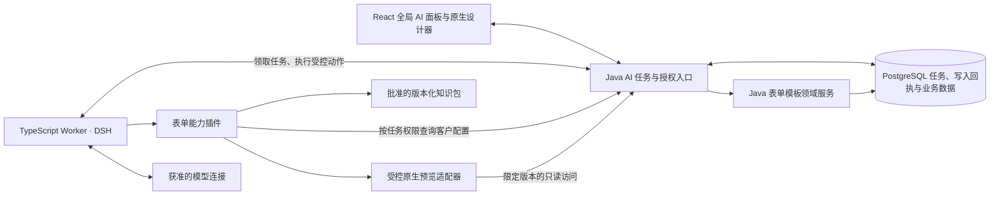

# eDHR AI 工程骨架与表单试点设计

本文件为方案草案。代码基线为 `codex/ai-experiments@9c18e27793a2bfa693957e0319ceea2d25b0fcf2`，对照 `edhr-dev@3ae01d53dda205de277f4aa09b92fbbb9a337468`，知识基线为 0.3.25。本设计用于安排首个产品切片，业务规则和发布资格以现行契约为准。

2026-11-12 工程启动：用户已授权补齐AI协作本体、运行契约并开始后端骨架。商用工程评估认为可进入建设，不代表可上线。原切片1拆为1A任务执行底座与1B原生写入；本轮实现1A，1B保留全部原验收条件。当前边界见[产品Agent运行契约](ai-agent-runtime-contract.md)，实现与验证入口见[任务底座1A](../development/ai-task-foundation.md)。本稿后文的“本轮仅设计、未做独立门禁”描述早先评审时点；本次门禁按新决策包与实际结果记录，不能沿用旧时点结论。

2026-11-12 架构评审补充：用户已确认按评审意见补齐工程骨架和执行契约，本轮仅修改本设计稿。以下新增约定是待实现的设计目标，不表示代码、知识投影或生产资格已经通过验收。源码与契约读取基线为上述 `9c18e277`，未更新远端或改变 Git 状态。

[DSH 实验](../experiments/ai-form-agent-dsh-20261112.md)已验证 DSH 能运行同一个表单插件、切换模型、卸载工具并恢复会话。六次正式运行中五次保存成功，DeepSeek 报废单未通过校验。进入产品开发的目标是把实验能力接到真实身份、权限和业务写入链路，并验证用户能在原生设计器里继续工作。

## 首版产品范围

从全局 AI 入口输入“在某分类下按这份表建表”。首个输入范围采用单工作表的空白或脱敏 XLSX，与已验证样本一致。用户可以提供表单名和版本，省略时按原表标题和现有模板默认行为处理。分类、重名或统计口径有实质歧义时只询问受影响部分。可判断的布局、字段和引用先做，未知业务绑定暂缓并留在任务结果里。

Agent 自检后直接在标准表单模板模块保存，结果卡打开确定的模板与版本。用户在原生设计器继续拖动或调整字段，也可以回到同一任务让 AI 修改。首版 AI 写入限定为本任务新建的版本及其后续编辑，便于闭环验证。手动编辑其他模板走现有流程。

首批部署在隔离实施环境。模板沿用现有对象和版本规则，任务状态单独保存。进入真实生产环境前，需核对新建和未完成模板何时可被生产选用。现有分类和设计任务状态不能作为生产隔离条件。首版范围不含自动绑定生产作业、执行、签署和放行。

## 组件与所有权

| 位置建议 | 责任 |
| --- | --- |
| `gmp-platform/frontend/src/` 的独立 AI 功能目录 | 在 `AppLayout` 挂载按权限加载的入口和任务面板，复用现有模板页、设计器和预览。 |
| `gmp-platform/backend/` 中独立的 AI 模块 | 对前端暴露任务与能力接口，登记用户、安装实例、插件版本和目标，负责权限、持久状态、审计及内部工具入口。 |
| `gmp-platform/ai-worker/` | 独立 Node.js / TypeScript 进程。显式装配已验证的 DSH 组件，维护模型适配、会话和附件。初期单 Worker 和持久卷，任务由 Java/PostgreSQL 领取。 |
| Worker 内的表单插件 | 复用实验的本体查询、布局、局部编辑和语义检查。提供声明式能力 ID、版本、依赖模块、工具和结果类型。 |
| Worker 内的原生预览适配器 | 在受控无头浏览器中复用原生表单渲染，以短时、限目标的只读凭据取得指定修订的预览，返回截图与测量结果。首版随 Worker 部署，不新增独立微服务。 |

**扩展路径**采用 `project-plugin` 承载表单 Agent 能力，`standard-action` 承载 Java 的受控表单命令，`product-core` 只承担共同的权限和事务约束。首版只有一个内置插件注册表和一个模型适配边界。能力可按安装实例配置启停，后续付费授权接入同一能力判定。AI Worker 可以独立部署和升级。主系统启动及普通表单流程无需等待 Worker 健康检查。

Java AI 模块组织为任务编排、能力判定、领取与预算、受控动作入口；表单创建和保存仍由表单领域服务拥有。Worker 组织为任务客户端、DSH 运行时适配、模型适配、表单插件和预览适配。Java 接口与业务存储不使用 DSH 类型或会话格式；DSH 会话仅由适配器解释。暂不引入独立消息队列、通用工作流引擎、动态代码上传或插件市场。

## 核心契约

**任务与授权。** 前端从 Java 读取能力可用性，再创建、读取、停止任务或提交业务补充。可用性由安装开关、能力授权、表单模块与当前用户权限共同决定。首版采用配置授权，不接计费。任务绑定服务端解析的用户与安装实例。Worker 用仅限内部接口的服务身份领取任务，Java 从任务记录解析发起人和目标，每次受控读写重新解析当前权限。上传内容、模型参数、前端页面上下文均不能授予访问范围。首版针对当前默认单租户部署，不推断已有多租户隔离。

首版拟用 `GET /api/v1/ai/capabilities` 发现能力，`POST /api/v1/ai/tasks` 创建任务，`GET /api/v1/ai/tasks/{id}` 读取状态，`POST /api/v1/ai/tasks/{id}/actions` 提交补充、继续或停止。创建任务用用户和安装实例下唯一的请求标识处理双击及传输重试。前端只提交任务指令与已授权的附件引用，不传 Worker 服务凭据。

### 任务、轮次与持久化

任务是长期协作容器；执行轮次是一次可停止、可恢复的 Agent 执行。任务不因一次完成或接手而失去继续协作能力。每个任务同时最多有一个排队或运行中的轮次。用户继续、补答后续做或再次交给 AI 时创建新轮次；同一轮次因进程故障被重新领取不等于用户发起新轮次。

| 逻辑对象 | 最小持久内容与约束 |
| --- | --- |
| `Task` | 用户、安装实例、能力、创建请求标识与摘要、指令与附件引用、确定目标、当前轮次、成果和未决问题。任务首次创建模板最多一次，目标不得由模型换成其他版本。 |
| `Run` | 轮次 ID、任务 ID、状态与原因、起始修订、固定的插件/工具协议/知识包/模型配置、会话引用、领取代际和期限、累计消耗。 |
| `OperationReceipt` | 任务、轮次、操作 ID、服务端计算的规范化请求摘要、动作、目标、提交后的修订和结果。唯一键阻止同一操作重复写入；首次建表另有任务级唯一约束。 |
| `EditOccupancy` | 目标版本、任务/轮次、领取代际、期限；同一目标最多一项有效 AI 占用。与模板的 `lock_version` 分开。 |
| `Question/Answer` | 稳定问题 ID、问题修订、影响字段与用途、配置依据及适用修订；回答记录认证用户、时间、原文及适用范围。可作为任务的结构化内容保存，首版不强制单独建表。 |

这些是逻辑记录，具体表划分在迁移切片落实。PostgreSQL 是任务状态、领取资格、预算和业务回执的权威来源；DSH 对话与检查点不决定某次业务写入是否已成功。

| 轮次状态 | 含义与合法后续 |
| --- | --- |
| `QUEUED` | 等待 Worker；成功领取后进入 `RUNNING`，用户可停止。 |
| `RUNNING` | 按有效领取资格执行；可以结束为下列任一终态。领取到期后可由新代际恢复该轮次。 |
| `WAITING_INPUT` | 存在有范围的业务问题；可确定成果已保存，若分类等前置问题阻止创建则允许尚无模板。释放占用，补答续做创建新轮次。 |
| `SUCCEEDED` | 当前修订满足完成条件，无未决问题或已知缺陷；继续修改创建新轮次。 |
| `PARTIAL` | 有成果但仍有质量缺陷、预览失败或预算耗尽等未完成事项；释放占用，结果不冒充成功。 |
| `STOPPED` / `FAILED` | 用户接手、能力撤销或执行故障等结束本轮；保留已提交成果。原因码区分可解释的停止原因，重试创建新轮次。 |

终态不回退至 `RUNNING`。界面显示最新轮次的状态，同时独立显示已有成果；“本轮失败”不等于“模板未创建”。领取到期但尚未完成恢复核对时不授予写入资格。

### 受控写入与回执

第一次成功写入把模板、首版本、校验后的设计、业务审计、任务目标绑定和写入回执放进同一事务。后续只接受本任务的确定模板版本。动作至少携带 `taskId`、`runId`、`leaseEpoch`、`operationId`，修改时携带 `expectedRevision`；安装实例、发起人和目标归属由 Java 从认证与任务记录解析，不信任模型参数。

Java 在短事务内核对当前授权、轮次、领取资格和占用，再执行领域校验与写入。首次创建时在该事务建立目标占用。模型调用、文件解析、截图不得置于数据库事务或行锁内。业务审计记录真实发起人及 AI 执行来源、任务、轮次和动作，不能把 Worker 服务账号冒充业务用户。

相同操作 ID 与相同请求摘要返回原回执，参数不同则拒绝。回执重读仍检查当前读取权限，不产生新写入；停止或失效领取者不得执行新动作。结果未知时先查回执，已提交就读取结果；未提交且执行资格仍有效时才可用原操作 ID 重试。不得生成新操作 ID 绕过结果核对，也不得因 DSH 重放而重复建表。

### 编辑占用、版本检查与人工接手

`lock_version` 防止过期数据覆盖；编辑占用表达当前 AI 的写入资格，两者均由服务端检查。优先提取现有创建、保存与审计为共享领域服务，人工保存、自动保存、AI 保存均经过相同的修订和占用约束。会改动或删除目标版本的其他入口也必须核对占用，不能只保护设计 PUT。

1. 用户把当前设计交给 AI 前，先完成已在途的保存，并成功保存未保存修改；保存失败或冲突则不启动接管。明确选择放弃修改时才能丢弃本地内容。未在当前页打开的目标以服务端最新修订为基线。
2. 领取与取得占用后重新读取最新设计。人工修改后继续时，重建本轮字段与画布基线，保留原字段身份和人工变更；旧 Agent 草稿不能整份覆盖新设计。若存在无法导入的原生配置则停止受影响编辑并说明，不能静默删掉它。
3. 同一版本被 AI 占用时，其他标签页或用户仍能查看，服务端拒绝人工写入。首版只允许任务所有者且仍有编辑资格的用户主动接手；其他用户等待占用释放或到期，不新增管理员强制接管权限。
4. 停止、领取换代、占用更新和写命令采用一致的锁顺序并串行判定。若写事务先完成，接手结果包含这次提交；若停止先完成，后续写入拒绝。接手成功响应意味着该旧轮次已不可再写，不等待模型响应结束。
5. 接手后读回最新修订再开放编辑；停止不会撤销此前提交。前端收到超时不得自行宣告接手成功，需查询服务端状态。重新执行会产生新轮次，旧请求始终无效。

占用由有效领取续期，并受配置的运行时限约束。到期后旧代际不能写；恢复必须重新领取、取得占用并核对当前修订，不能只延长旧 token。即使首版只有一个 Worker，也必须通过“旧 Worker 失联、新 Worker 接替、旧 Worker 返回”的故障验收。

原生版本读取和保存响应要返回持久化提交后的 `revision`，人工手动保存与自动保存提交对应的 `expectedRevision`，每次成功保存后更新本地基线并串行发送本页保存。缺失版本不得默认采用最新版本绕过检查。接口与前端需协调发布；旧客户端在受影响写入口得到明确的刷新提示，普通手工设计功能继续可用，不保留无版本校验的覆盖通道。

### 恢复与运行时边界

恢复按“核对插件与知识兼容性 → 当前权限与领取 → 写入回执 → 最新目标修订 → DSH 会话”执行。会话记录落后于数据库时，以回执和当前对象重新建立工具结果；无法可靠重建时标记失败并保留成果，禁止猜测重放。若发现人工修改，转入最新设计基线重新规划，既有检查与预览结果失效。

会话文件和附件首版放持久卷，Java 保存不透明引用及必要摘要。缺文件、文件损坏或版本不兼容时明确报错；不能用空会话自动重建已有模板。单 Worker 加持久卷不等于高可用，备份恢复需同时核对数据库回执与会话文件；首版不承诺多节点无损迁移。

### 领域校验、Agent 自检与补答

| 校验归属 | 责任 |
| --- | --- |
| Java 表单领域服务 | 当前权限与归属、修订和占用、合法结构与引用、产品现行配置约束、事务和审计。人工与 AI 共用；Worker 的“校验通过”不能豁免这些检查。 |
| 表单插件 | 原表填写位置覆盖、漏建与多建、布局、来源依据、业务用途遗漏和待问项，以及原生预览反馈后的局部修复。无需把全部布局启发式在 Java 重写。 |
| Java 任务编排 | 区分保存成功与任务成功；检查完成报告、问题和校验/预览证据是否属于当前修订及本轮。模型的自然语言完成声明不改变任务状态。 |

尚未确认的业务绑定暂缓，不能凭字段名称制造统计职责。保存允许的中间设计不等于可用于生产。`SUCCEEDED` 必须有当前修订的读回、确定性检查与预览证据，且无待问项及已知缺陷；有业务问题用 `WAITING_INPUT`，质量或运行限制用 `PARTIAL`。保存后继续修复会使旧证据失效。

补答关联 `questionId`、问题修订与受影响配置，不把任意一条“是”视为通用确认。字段或依据变化时先重新判断回答是否仍适用；不适用的回答保留历史但不生效。模型可以解释与整理回答，不能把推断写成用户已确认。回答默认只作用于当前任务；是否提升为可复用客户实施政策另行授权，首版不自动写入全局知识。

**知识与模型。** 本体工具通过任务上下文检索现行规则、相关关系和许可范围内的客户实施配置，保留来源与版本。首版按能力投影批准的知识子集，不将开发仓库完整资料作为模型上下文。文档解析先生成稳定的单元格与填写位置 ID，模型通过 ID 配置字段。参考数据与目录由 Java 按授权提供。模型只见批准的输入和结构化工具，无通用系统操作工具。调试优先 OpenAI，完整验收保留双模型。客户启用的模型与数据范围由部署策略配置，模型切换需通过同一验收。

### 知识包、插件启停与升级

知识包记录模型版本号、来源 Git 提交、内容哈希、适用产品版本与批准的投影范围。遵循现有成熟度、visibility、证据和执行契约约束；内部实验读取过的资料不因此自动获得客户可见或运行投影资格。发布可用的知识子集是表单插件切片的交付项，不能只复制整个开发知识目录。

任务创建时记录选定的插件、工具协议、知识包和模型配置；各轮次保存实际使用的固定版本，恢复同一轮次时不得静默切换。客户目录和权限是动态数据，查询及写入时重新核对；知识版本固定不意味着使用过期权限。新轮次默认沿用兼容基线，必须升级时重新建立基线并记录新版本和差异，不继续消费旧工具调用。

| 操作 | 首版行为 |
| --- | --- |
| 禁用 AI 或表单能力 | Java 立即拒绝新执行与后续受控调用，使活动轮次停止并撤销占用；Worker 取消后续模型请求。已发给模型的请求可能仍产生费用，不能宣称远端请求已撤回。 |
| 重新启用 | 重新计算授权；用户继续时创建新轮次，旧轮次不复活。 |
| 部署新版插件 | 新任务使用获准版本；旧轮次仅在固定版本仍可提供且兼容时恢复。版本不可用或协议不兼容则明确停止并保留成果，首版不自动迁移 DSH 会话。 |
| 能力关闭后的历史访问 | 按普通数据读取权限保留任务成果与原生模板访问，关闭付费能力不删除业务数据。 |

首版“热插拔”指配置授权即时启停和运行中工具失效；不承诺任意新代码无部署热加载。插件注册表只装配批准的内置插件。插件不直接访问业务数据库，Java 只开放该能力批准的命令集合。

### 可部署预览与附件

实验的 `v3/preview.mjs` 依赖本机 Codex Playwright 脚本、固定地址、有界面浏览器和测试管理员登录，不能原样作为产品实现。产品预览复用原生渲染组件，通过配置的内部地址和受控浏览器运行；凭据限当前安装实例、目标版本和只读用途，并具有短有效期。预览沿用任务发起人的数据范围，不使用管理员账号读取目录或真实业务值。

预览输入与输出关联 `taskId/runId/templateVersionId/revision`、内容哈希和渲染器版本；读取时核对修订，渲染稳定快照，输出后确认其仍是当前修订，否则旧截图不可作为完成证据。截图与模型消息遵守同一数据范围策略。预览失败保留已保存模板并报告 `PARTIAL`，不以模型自述“已看过”替代证据。

上传附件先绑定认证用户与任务，校验类型、大小及解析后的工作表/单元格资源上限；解析不执行宏、公式脚本或外部链接。文件内容始终作为数据，不产生工具授权。附件、截图和会话按部署的保留策略清理，先核对活动任务依赖；业务模板与审计不随临时附件清理被删除。

### 预算与失败收敛

服务端保存任务累计模型请求、用量/估算费用、在途预留、每轮运行时限与同类失败计数。预算在发请求前原子预留，完成后按可获得用量结算；进程重启不清零，用户创建后续轮次也不自动重置任务总预算。供应商账单可能滞后，估算限制不冒充精确费用上限。结果未知的已发请求保留消耗预留，核对前不自动退款或重放。

请求次数、输出上限、运行时限及同一错误连续重试上限由部署配置给出并记录于任务，首个运行切片必须设置有限值；实验的 26 次请求和 5 美元限制不直接作为客户默认值。相同错误重复且设计无进展时停止修复循环；有成果则 `PARTIAL`，无成果则 `FAILED`，保留错误及下一步。授权、版本冲突和占用错误不按瞬时网络错误盲重试；限流等可恢复错误采用有界退避，仍计入时限与预算。

### 最小接口约定

| 接口/动作 | 最小约定 |
| --- | --- |
| 创建任务 | 请求标识在安装实例与用户范围唯一；服务端计算摘要，相同请求返回原任务，不同内容拒绝复用。附件引用必须属于可授权输入范围。 |
| 获取任务 | 返回当前轮次、已有成果及修订、问题、占用、可执行动作和进度序号；按对象权限过滤，单租户不等于用户间可互读所有对话。 |
| 提交动作 | 明确 `continue/answer/stop`，携带动作请求标识与预期当前轮次；回答另带问题修订。旧页面的停止命令不能误停刚创建的新轮次。 |
| Worker 领取/续期 | 使用内部服务身份；服务端产生递增领取代际和截止时间，数据库约束同一任务的活动轮次及目标占用唯一性。 |
| 受控工具/查回执 | 使用任务、轮次、代际、操作标识和预期目标修订；认证、即时授权及领域校验不能由调用方跳过。 |
| 完成轮次 | 提交结构化结果与证据引用，服务端核对本轮资格和当前修订，再记录终态并释放占用。 |

拒绝原因使用可判定的类型：权限/能力不可用、旧轮次、领取失效、版本冲突、目标占用、幂等参数冲突、预算耗尽和证据不完整。客户端按原因展示与恢复，不依赖匹配模型文本。内部接口具体 URL 随第一个切片确定，不对客户暴露 Worker 凭据或 DSH 接口。

## 第一版交互

全局入口放在 `AppLayout` 的顶部工具区，面板切页保持任务。指令、附件、当前阶段、待确认问题和“打开表单”是主路径。后台任务可以先通过轮询同步状态，页面事件来自服务端任务进度，不依赖模型自由描述。

在 Agent 修改用户当前打开的模板版本时，设计器显示蓝色半透明边框和明确的“AI 正在修改”状态，并提供“停止并接手”。占用范围是当前模板版本，不代表 AI 控制用户电脑；用户仍可浏览其他页面。界面先处理未保存内容，再启动接管；接手由服务端终止当前轮次的写入资格，按上述事务顺序读回最新版本后开放编辑。其他标签页依据服务端占用显示只读状态，轮询延迟不影响服务端拒绝冲突写入。字段配置有待确认时仍可打开已生成版本；补答或人工修改后继续，在同一对话任务里创建新轮次。整个流程没有额外应用操作。

## 开发顺序与验收

| 切片 | 交付 | 验收 |
| --- | --- | --- |
| 0. 执行契约 | 本文的任务/轮次、占用、回执、恢复和版本边界；落实受影响知识及独立审查。 | 状态、对象归属、写入顺序、失败结果与以下场景逐项对应；不得以文档存在代替验收。 |
| 1. 后端纵切与原生保存 | 安装开关、能力注册、Java 任务与轮次、真实授权、领取代际、占用、共享领域动作、幂等回执与持久预算；原生设计器读写修订同步改造。用固定合法样本驱动。 | 真实用户创建原生模板；双击和提交响应丢失不重复建表；停止与提交竞态、领取换代、过期客户端、撤权和预算恢复符合契约；AI 停机不阻断普通手工功能。 |
| 2. 表单插件与预览 | 接入 DSH，产品化上传解析、知识投影、填写位置 ID、局部编辑、补答、自检和受控无头预览；固定插件/知识/模型版本。 | 三张基准表及一张此前未用于调试的变体；检查漏建、多建、合法引用、业务绑定、真实读回和版式；验证人工修改后续做、旧回答失效、预览故障、版本不兼容和失败收敛。 |
| 3. 产品入口 | 全局面板、进度、成果打开、待问续做和接管状态。 | 实际浏览器验证上传、切页、刷新、未保存内容、跨标签页占用、停止接手、继续与撤权；视觉状态与服务端资格一致，回归手工建表。 |

首个纵切的强制故障验收包括：提交前崩溃无业务结果；提交后响应丢失可查回执；旧 Worker 在新代际领取后返回不能写；停止与写入两种事务先后顺序均有确定结果；手动保存后的 AI 续做不覆盖人工变更；能力关闭、权限撤销与过期轮次不能调用新写入；同一幂等键不同参数被拒绝；重启不恢复已消耗预算。双模型质量验收单独报告配置质量、真正业务问题、遗漏、耗时与费用，不能用故障测试通过替代表单可用性。

第一阶段只需一个可重复的纵切，数据库沿用 PostgreSQL，运行时沿用 DSH。工作量集中在现有表单服务复用、权限实查、保存兼容和故障验收。先通过这些关口，再扩大解析格式或增加插件。首版的导入、问数、插件市场、完整计费、多租户 SaaS 和生产托管另行规划。

## 当前实现证据与影响

- [TemplateModelingController](../../gmp-platform/backend/src/main/java/com/zencas/edhr/template/controller/TemplateModelingController.java)已经提供建表、版本与设计保存，列表和创建仍依赖默认租户，设计保存有表单权限注解。不能用该接口的 401/403 证据外推创建和查询。设计保存的写入与审计集中在控制器中，抽取范围以共享动作所需为限。
- [FormTemplateVersion](../../gmp-platform/backend/src/main/java/com/zencas/edhr/template/entity/FormTemplateVersion.java)已经有 JPA `@Version`。现有设计保存请求没有从编辑起点提交的预期版本检查。 [JwtAuthenticationFilter](../../gmp-platform/backend/src/main/java/com/zencas/edhr/identity/security/JwtAuthenticationFilter.java)从 JWT 提取权限声明，后台任务需调用现行权限解析。
- [AppLayout](../../gmp-platform/frontend/src/components/shared/AppLayout.tsx)已有全局工具区与路由出口。 [TemplateModelingPage](../../gmp-platform/frontend/src/pages/master-data/TemplateModelingPage.tsx)与现有设计器是结果打开和人工接管的载体。
- 原始源码证据：当前版本响应没有暴露 `lockVersion`，设计器手动与自动保存没有提交预期修订；[实验工具](../../scripts/ai-form-agent/v3/tools.mjs)检测外部修改后拒绝继续，且结束会话不能直接续做；[实验预览](../../scripts/ai-form-agent/v3/preview.mjs)依赖本机工具和测试登录；[实验预算](../../scripts/ai-form-agent/dsh/provider.mjs)计数位于进程实例。这些是产品化需改造的真实边界，不是已实现能力。
- 实现时预计只新增 AI 任务相关存储并保持现有模板数据可读。业务写入权限与版本冲突会影响原设计器，需聚焦回归。生产快照依 `DEC-0077-12` 继续在生产实际使用时冻结，AI 任务不改写历史快照。追溯与统计仍是独立可选用途，相关规则见 `DEC-0077`。
- 需要在首个实现切片验证实际权限解析与调用入口、提交响应丢失、已有手动客户端的版本兼容、审计关联和部署启停。试点与正式生产选用范围根据实际部署环境另行核对。

## 影响范围与验收状态

本次设计补充直接影响未来 AI 任务、插件和表单设计器写入链路，传递影响版本读取、自动保存、删除入口、认证授权、审计及临时附件；潜在影响为知识包发布资格与生产选用未完成模板。原生生产执行、签名、放行、历史快照和其他 AI 能力不在本轮改动范围。后续只增加必要的 AI 存储和现有版本响应字段，不改变模板历史含义；停用 AI 保留原生模板与审计，停止任务不作业务回滚。

知识版本固定与现行权限动态核对分开；生产实际使用时冻结仍遵循 `DEC-0077-12`，不能将 AI 任务状态当作发布状态。第一阶段仅隔离实施环境可验收；正式生产的模板选用边界仍是明确暂缓项，未闭环前不进入生产试用。已有全量知识投影资格、迁移方案、真实并发与性能尚无本轮运行证据。

证据分级：源码核对为 `original-evidence`；既有实验报告为 `secondary-reference`，本轮未复跑；用户接受评审意见为 `user-confirmed`；本文件的对象拆分、接口和部署安排为待验证的工程设计。没有修改业务代码、迁移、配置或权威知识资产，不提高现有知识成熟度。

执行级别为 L2。此次补充涉及新的执行契约设计，不能继续沿用初稿的“门禁不适用”结论。本侧会话禁止调用子智能体，故本轮仅进行文档自检，独立本体同步/核对和质量门禁尚未完成；不能记录为 `updated` 或 `passed`。本稿作为待实现、待独立核验的设计输入保存；正式工程切片需将已确认规则同步到适用知识资产，完成独立审查及上述运行验收后方可宣告交付。
