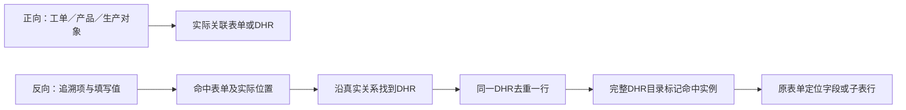

# 业务报表固定筛选与表单、DHR正反向追溯复核

日期：2026-10-13。执行级别：L2设计与调研；沿用`DEC-PACKAGE-20260929-FORM-PROJECTION`，知识基线0.3.24，源码基点`c38aa03d`。本轮没有修改运行代码、接口、数据库、权限或生产证据；调研与设计说明不能视为功能已实现。

## 用户已确认的方向

- 业务报表查询条件由产品按报表预定义，参考冠骋，不采用逐条选择字段的“添加查询条件”交互。
- 表单追溯分正向、反向。正向通过表单真实关联的工单、产品、生产对象等属性查表；反向通过表单中填写且绑定追溯项的值查表。
- 反向追溯需要支持客户维护的自定义追溯项；条件和值控件遵守产品实际支持的类型。
- 增加DHR追溯报表，沿用正反向含义，参考冠骋的查询、列表和详情展示。
- 用户通过异步回复确认：DHR反向多个条件在同一DHR范围内满足即可，允许由不同表单分别贡献命中；表单反向仍保持同一表单、同一实际子表行规则。
- 既有规则继续适用：成功保存/暂存后过程内容可查，未保存输入不可查；内容命中不改变真实生产或DHR归属。主表条件同一表单满足，子表条件同一实际行满足。

## 当前实现核对

`FormProjectionReportPage.tsx:92`已经把候选来源分开：表单追溯取客户追溯目录，三业务报表取`businessFilters(modelId)`产品预设字段。`FormProjectionController.java:53–61`追溯查询走目录与`FormTraceIndexService`，`:63–102`业务查询走正式业务记录、冻结上下文及表单审计属性。业务字段无需另勾追溯用途也能筛选，名称相同不等于同一目录。

当前不清楚的交互来自两种查询共用“选字段、填值、添加条件”界面。另有实际遗漏：无条件调用`useFormLookupItems`且目录失败提示没有模型判断，业务页仍会请求追溯目录并可能显示不相关错误；这不改变业务筛选的数据来源。

当前表单追溯还没有正向/反向分区。`FormTraceIndexService.java:103–115`要求存在已配置的内容索引，即使用户只按真实所属对象查，也会排除没有追溯用途的表单。该行为不能当作完整正向追溯。现有`FormInstanceQueryService`提供真实表单实例注册表读取，可作为正向实现锚点。

当前DHR实例列表及详情已具备真实归属、目录、当前表单证据和冻结汇总版本，但没有独立DHR内容反向检索。`FormProjectionController.java:196–217`的DHR回查按实际表单对象关系连接DHR，不能改为按内容编号认领DHR。

## 冠骋原始证据

本次直接读前后端源码。先前调研报告只用来定位，属于`secondary-reference`；下列源码、此前用户提供的原始报表截图属于`original-evidence`。外部目录没有可确认的Git版本，部署元数据与实际请求未取得，不能把本地代码全部推定为部署行为。

前端根目录：`/Users/ivenwang/Documents/iven space/paas-main-front/`。
后端根目录：`/Users/ivenwang/Documents/iven space/gct-edhr-bed/gct-edhr-bed/`。

| 原始位置 | 本次直接核对的事实 |
| --- | --- |
| 前端`src/projects/web-render/src/views/edhr-application/render/document-tracked/index.vue:4–14` | 表单追溯两个页签，默认正向，反向受`Reverse`权限控制 |
| 同目录`trace.vue:94–170` | 正向固定条件为流水号、备注名、模板、表单类型、关联批次/SN、来源、状态、创建人及创建时间 |
| 同文件`:172–255` | 反向固定条件为批次/SN、产品、设备、工单、关联批次、记录单号、追溯日期及订单号；模板及填报人已注释。`relatedLotNo`的中文标签由`sys/pageDesigner.ts:425`确认为“关联批次”，不能仅凭字段名改称物料批号 |
| 同文件`:257–312,333–340` | 两向均返回分页表单实例，按实例ID打开详情；此详情调用未传查询值高亮参数 |
| 前端同应用`render/edhr-tracked/index.vue:4–14` | DHR追溯也有正向/反向页签，反向受其自身页面的`Reverse`权限控制 |
| 同目录`trace.vue:80–217` | 正向有记录类型、批次/SN、工单、DHR状态、产品、创建人/时间；反向有产品、设备、工单、填报人、记录单号、关联批次、追溯日期、订单号，批次/SN是共用候选 |
| 同文件`:220–259` | 行类型为DHR实例；列有批次/SN、工单、产品编码/名称/规格、DHR模板名、创建/完成时间、创建人、记录类型及DHR状态 |
| 同文件`:299–332` | 打开DHR整体详情，另查命中目录和表单ID，向详情传目录/实例标记，不把结果列表改成表单列表 |
| 前端`components/search-form/index.vue:159`及`components/trace-select/utils.ts:6` | 条件数组来自页面固定定义；动态加载实体候选值不等于动态增加查询字段 |
| 后端`src/main/java/com/gct/apaas/edhr/notebook/FormTraceManager.java:91–116,225–276` | 按既定追溯字段采集主/子表内容，主体与内容字段分开；不同字段类型的值会做笛卡尔积，不能支持我方同一实际行组合规则 |

原报工、报废、消耗截图分别展示固定业务条件，没有“添加筛选字段”入口。冠骋这份源码的表单、DHR反向条件也为固定数组，未找到客户追溯目录动态追加任意项的实现。我方自定义追溯项属于用户明确需要的扩展，不伪称照搬冠骋已有功能。

可见后端另有POST `reverseTraceList`业务服务；它不是前端使用的GET分页入口。GET入口的Controller/Service/DTO属于未取得的平台依赖，精确组合算法、状态范围和全部权限不能假装已核对。`FormTraceManager`还会对其他编号建立`AUTO_CONNECT`，这一外部行为不适用于我方已确认的真实归属边界。

DHR原始详情标记还有两项不能照搬的差异：`EdhrReverseTraceBs.java:35–42,79–81`未映射页面已有的填报人、关联批次和订单号条件，未知项被跳过，不能声称其列表和详情标记完全一致。可见`validateAllowedVisit`最终使用`NoPermissionService`和`QueryControlConst.java:13–18`关闭数据规则/字段权限，函数名本身不是有效数据隔离证据。我方列表、命中标记和来源详情必须使用相同条件与已授权证据范围。

## 我方建议的查询和展示

以下具体字段组合、主次展示、结果粒度及DHR命中表现为`inference`设计建议；已确认的正反向含义与独立入口方向不再重复询问。

### 三类业务报表

| 页面 | 固定常用条件 | 列表粒度 |
| --- | --- | --- |
| 报工记录 | 工单、生产批次/SN、产品、工序、报工人、生产日期范围 | 一行一笔报工记录 |
| 报废记录 | 工单、生产批次/SN、工序、报废物料、物料批号、报废分类、报废原因、创建信息 | 一行一笔报废记录 |
| 消耗记录 | 生产批次/SN、工单、物料、工序、更新人及更新时间范围 | 一行一笔消耗记录 |

单位、班组、单据等已有低频过滤可以保留为固定的“更多筛选”，不要求用户先选择筛选字段。筛选控件与来源类型一致，不从追溯目录决定候选。创建/更新条件须明确实际对应表单还是业务事实，不能把当前表单审计字段悄悄改称业务发生时间。三报表仍读取最终完成事实，不因查询布局改变生效时机。

### 表单追溯

正向固定条件建议：工单、产品、生产批次/SN、表单名称/实例号、工序、来源、记录状态、创建/更新时间。按真实实例关系查，未配置追溯用途的已保存表单也应可查。字段值中的“工单号”不代替真实所属工单。

反向：常用预置追溯项可固定显示，自定义项通过“添加追溯条件→选择追溯项→填写值”加入。只查询已明确绑定的保存内容，不对任意字段做全文猜测。当前目录仅支持文本，索引接受文本、单选及兼容引用；日期和多选控件不能只照前端候选显示而绕过未实现的类型/操作符。

两向结果建议每份表单一行，显示实例号、表单名称/版本、真实工单、产品、生产对象、工序、来源、状态及创建/更新信息。反向增加命中项、命中位置及值摘要；详情沿已有只读原表单定位。正向没有内容查询命中时，不造字段高亮。

### DHR追溯

正向固定条件建议：DHR编号、生产批次/SN、工单、产品、DHR模板、DHR状态、创建/完成时间。使用DHR真实冻结上下文和现行状态解释，不复用冠骋的状态枚举或“记录类型”含义。

反向从已绑定追溯项的表单内容查实际关联DHR，共用追溯目录与值控件，不另建DHR追溯项目录。只保留真实关联链，提到其他生产对象不会使表单成为那个对象的DHR证据。

建议每份DHR一行，即使命中多份表单也不重复显示DHR；显示DHR编号、生产对象/类型、工单、产品编码/名称、DHR模板/版本、DHR状态、创建/完成时间，反向另有命中表单数与摘要。

详情先打开完整DHR目录及来源视图，标记命中的目录/来源组及具体表单实例，可从命中清单直接进入那份原表单并定位实际字段或子表行。保留其他证据的上下文，不用“只剩命中表单”的过滤视图冒充完整DHR。

查询依据与详情必须一致：当前生产记录读成功保存内容，冻结汇总版本读该版本的冻结证据，终止DHR沿现行终止快照。不能用最新值命中却打开旧版本正文。冻结版本反向检索及历史查询仍须明确分期，不由新增入口自动关闭A12；受控附件不进行未经确认的OCR或全文追溯。

## 组合规则与影响范围

DHR反向组合规则已确认：同一DHR范围内，每个条件都要有真实关联证据满足，但不要求各条件出现在同一份表单。例：上料表记录M001，设备记录表记录E01，两个条件共同命中这一份DHR。详情分别标记两份贡献表单，不伪造一笔同时使用M001和E01的业务明细。表单反向仍按同一表单/子表实际行匹配。DHR去重、命中表单数及具体摘要展示为工程设计建议，组合规则本身是用户明确确认。

最小影响分析沿同包维护：直接影响业务查询交互、表单正反向入口及新增DHR追溯；传递影响真实关联读取、目录命中定位、索引与展示快照一致性、来源权限及分页去重。当前无运行修改或数据迁移；不改变生命周期、签名、统计事实或生产/DHR归属。扩展路径为`product-core`（查询边界、目录/实例定位及共享控件）与`configuration`（客户追溯目录和明确绑定），不添加客户条件分支。

未来验证必须覆盖未绑定追溯的正向表单、表单中提及其他对象、同值不同子表行、同一DHR多份命中、跨表单组合策略、当前/冻结/终止来源一致、无权DHR及无权表单、分页总数与去重。运行验证应在实现时执行，本轮源码调研不替代这些验收。

## 本轮验证

本体结果为`ontologyResult.result: updated`，知识基线保持0.3.24；确认规则写入`DEC-0075-39`，具体展示方案保留`inferred`，没有注册新的运行事实或执行契约。本体实际执行`BusinessKnowledgeModelTest`，59项、0失败/错误/跳过；184份知识及决策包YAML解析通过，引用和原始文件指纹核对通过。日志为`/tmp/edhr-form-dhr-trace-query-knowledge-20261013.log`。

主智能体完成本轮差异、决策唯一性和报告引用核对，184份YAML解析及`git diff --check`通过。全新独立质量实例`trace_directions_design_quality_20261013`返回`qualityResult.result: passed`，覆盖10份本轮文档、用户确认与设计建议分层、原始源码及六份指纹、L2影响分析和来源权限/快照边界；无发现和阻塞。其独立`BusinessKnowledgeModelTest`同为59项、0失败/错误/跳过，日志`/tmp/edhr-form-dhr-trace-query-quality-20261013.log`，184份YAML及新增引用检查通过。

本轮没有运行代码修改，未执行产品浏览器、业务API或数据库验收；知识与调研验证不证明拟定功能已经运行。前一轮查询边界解释的`not-applicable/passed`只覆盖只读事实核对，不能替代本轮新增正反向及DHR设计门禁。固定业务查询布局、完整表单正向、DHR反向及具体命中呈现待运行实现；历史版本反向/A12仍按既有分期保留。
