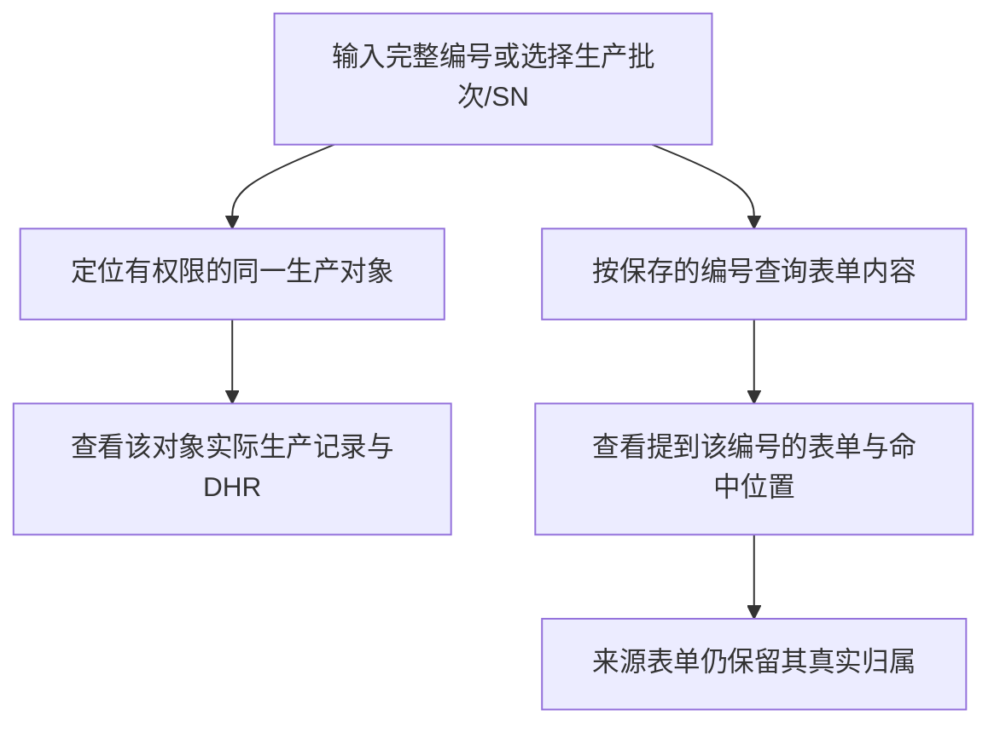

# 投影设计注释复核：查询、身份、子表与统计维度

后续生效说明：第二轮注释已明确确认MVP开发历史处理、预置所属生产主体和查询同表单/实际行原则；对应候选状态以[第二轮澄清](form-projection-design-clarifications-2026-10-09.md)及DEC-0075后续条目为准。本报告保留第一轮核对时点，其余建议不自动提升为confirmed。

日期：2026-10-09；执行级别：L2 设计评审；复用 `DEC-PACKAGE-20260929-FORM-PROJECTION`；知识基线 0.3.24；HEAD `b63d68ee299de9a286bf4cc1cad0d0d829e39217`。

本轮逐条回应用户的十一条注释，不实施运行代码、数据库、迁移、字段生命周期或统计默认。保留上一份侧栏评审结论，但根据本轮原始证据修正其中过窄的解释。所有新方案为 inference/待讨论，不能提升为 user-confirmed 或关闭 Q6/Q9/Q12/Q15/Q17。以前未提交的评审文件和无关 output 目录均保留。

## 首先修正此前解释

1. 生产对象编号在同一租户内唯一，BATCH 与 SN 共用 `production_object`，联合唯一约束不按类型分开。用户的前提在这个范围内成立。输入完整编号可以定位对象并查询其真实生产数据/DHR；这不等于将提到该编号的表单重新归属于它。
2. 批次/SN 已经是当前统计的上下文维度。此前“批次引用只有追溯”的说法描述了配置入口限制，却未解释系统自动提供统计归属，容易被理解为统计只有数量。这一解释必须修正。
3. 当前“相关生产批次号”确实是内置追溯项，并非客户自定义。可讨论调整默认展示，但不能把现状说成自定义，也不能删除其历史身份与绑定。

## 1. 查询输入、常用条件和生产批次/SN名称

建议生产对象条件采用输入过滤候选的 Autocomplete：输入 B00 搜索有权限的生产对象，候选显示编号、批次/SN类型、工单等信息，选择后查询目标使用对象ID。直接输入完整编号也可精确定位；零匹配不生成对象，不静默按其他编号查询。部分输入用于寻找候选，不应当作 DHR 模糊归属查询。

追溯条件分层，而不是所有内置项或自定义项全部平铺：

- 收起时优先两个常用条件，候选为“生产批次/SN”“工单”，第三列为重置/查询/展开；这是基于工厂主体入口的建议，不是已测得的使用频率。
- 展开提供设备、产品、记录单号等常见项；内置的物料批号、供应商批号等也可从动态条件选择，不要求内置即平铺。
- 其余使用“添加追溯条件 → 选择追溯项 → 相应值控件”。只显示用户添加的条件，增加、删除、展开不执行查询；查询/回车/重置和分页统一按现有规范。
- 控件依据产品支持的类型及操作符渲染：现有文字/单选来源对应精确文本或选项；受控生产对象/主数据项可以输入筛选选择。日期、多选扩展需明确操作符和语义，当前目录并未实现这些类型，不能先显示无后端能力的控件。

冠骋原始前端确有 LOT/SN 输入或选择、工单、设备、产品、关联批次、记录单号、日期范围、订单号等候选；正向/反向及 DHR/表单入口的条件有所区别，不应照搬成一个平铺面板。原始源码可得，本轮无需用户补截图；本轮没有运行冠骋页面。

建议统一产品展示为“生产批次/SN”，兼容两类生产对象以及文本来源。不能仅把当前批次项改名就宣称已完成统一：查询解释、引用兼容、目录标识、历史快照与旧SN项必须受控兼容。旧 stable ID 和证据不重写。“产品序列号”历史记录也未必都代表当前生产主体，不能全部直接迁移为同一种主体关系。

## 2. 同编号与同主体：限制语义和可支持的类型，不强制一种控件

建议同时支持文本、批次引用与SN引用表达生产对象编号，但限制不兼容类型（例如物料引用不能直接关联成生产对象身份）。自由文本不应该可转成任意模型身份；只有产品声明的语义和范围才可用于定位已有对象。

需要区分两条查询：



例如 A 表单真正属于 B001，B 表单也真正属于 B001，文字录入与引用选择不妨碍查询同一对象和DHR。若另一表单属于 A001、内容里提到 B001，它可以进入“提到B001的表单”，但不是B001的主体证据。

建议查询结果明确区分“生产记录/DHR”与“提到此编号的表单”，不把两类命中混成已绑定关系。统一目标入口是候选方案，不是当前页面已经实现的模式。定位与查询不修改历史原始字段、不把文本回填成引用ID，不建立生产谱系。

文本编号解析还须处理未知、改号/复用、大小写与历史编号、无权限以及旧引用无code等问题；当前同租户唯一索引不自动证明这些历史规则已定版。零匹配继续可作内容查询，但不能提供虚假的对象/DHR身份。输入候选过滤与最终编号匹配应使用明确的规范化规则，不因模糊搜索就扩大身份。

## 3. 相关生产对象与DHR主体

没有按某字段内容查表的需求，可以不配置相关对象追溯用途。实际生产对象及其DHR归集不依赖这个勾选。

当前 `lookup_related_batch` 初始化为 builtin=true，这是事实。建议不占默认常用区；需要关联/其他生产对象编号的客户可按目录配置对应含义。是否继续作为可选内置项属于产品取舍；本轮不移除已存在的目录项及历史快照。

本项目当前DHR主体是实际生产对象（批次/SN），表单与作业证据沿真实运行关系归集。多个对象的DHR可以被查询为相关结果，但内容命中不使一份表单同时成为其他DHR的主体证据，不替代未来受控谱系或跨事件关系。

## 4. 子表单列用途入口

建议保留单列追溯配置，因为某列的值确实独立表达一种信息。统计主配置放在整张子表；选中列时显示“本列作为实际物料消耗的物料/数量”等角色，可点明确的“编辑上料明细的消耗配置”修改同一份整表映射。

不建议每列都重复出现创建整笔业务、配齐所有字段和启用等操作。确有一张子表承载不同业务用途时，每项用途仍在整表管理，允许配置，但不能默认为每列各建一项。

## 5. 单位、必需信息、系统行身份与启用

### 单位

有效数量统计应有确定单位，否则2kg与3g无法安全合计。但“数量事实有单位”不等于“客户必须建一列并每行手填”。建议支持明确的来源：行内字段、配置固定单位、选中物料当时的单位。后两种目前未实现；必须保存当时依据，不在重试时读取最新主数据改写历史单位，也不默认做单位换算。

当前统计解释器要求单位来源且运行值非空，即使普通字段未勾required也会阻止最终完成。建议字段/配置处明确标示“该统计用途必需”，在填报期间尽早定位缺项，而不是最后才报错。物料、实际数量等必需角色不能仅因为未设置普通required就作为正式空记录通过。

单位未知时建议不生成可合计的正式数量；在当前Q5必要校验契约下，应先补齐必要信息。若产品要允许“无单位明细但不参与正式合计”，须明确它是否影响完成及下游，不能自动混入现有正式消耗口径。物料批号是否可空也不能一刀切推广到所有消耗：非批次管理物料是否存在及其规则是另一个变量，当前实现强制批号。

### 行身份

系统稳定UUID比客户维护明细编号更适合常见子表：新增时生成一次并保存；编辑与重排保留；复制/导入新行生成新身份；投影和重试读取被冻结身份。显示的01/02是顺序号，不是稳定身份。

不能仅在投影时生成UUID或把数组index当身份。当前RuntimeSubTable添加空对象、以index定位修改和签名请求，因此要一起检查正常录入、预览、复制/导入、签名定位、来源回查与审计，不只是加一个数据库字段。旧快照继续旧解释，不静默回填并承诺跨修订重建；A12仍延期。

### 启用

日常显式“启用”可以省掉：选择用途、配齐来源、预览、保存即可。内部仍保留配置草稿与可用性状态。建议完整配置保存后可供新生产使用，不完整可保存草稿，但必须明确提示且在生产使用前完成校验。高级停用可另行明确，不把展开复选框兼作删除或生效开关。此生效交互是建议，尚未实现/确认。

## 6. 同一份配置与备注等额外列

当前单列卡片打开的是整笔binding，因此修改会影响整表同一项用途。这份配置可以共享，但应清楚标明作用范围，不能分别复制成每列独立配置。

备注1/备注2按正常列保存，不要求关联到统计才能保存；原表回查即可看到。若报表明细详情需要直接展示它们，可设计可选的“补充展示字段”，保存字段身份与原值、按稳定来源行读取。它们默认不作为合计维度、不改变每行一笔、不要求制造新统计模型。目前没有任意备注映射的完整配置入口，不能说已支持自定义报表列。

例如同物料同批号两行，仅备注不同，不应因为备注不同默认拆成两组合计。备注参与追溯检索则另关联追溯项；参与统计分类则由预设模型定义语义，不能自动把所有额外列变成维度。

## 7. 主表分散字段交互

建议不再从每个字段反复“补充哪笔业务”。画布内先创建一张有业务名称的用途卡，例如“实际用料记录”，一次选择物料、批号、实际数量、单位来源。来源可以从清晰下拉框选择或点选画布字段；预览一句“这些字段共同形成一条实际消耗明细”。第二套确实代表另一笔业务时再新增卡片，并给出可辨识名称。

领料量、上料量与实际消耗量不默认等价。此例须确实记录实耗；如果实际是领料单，应使用产品另行定义的对应用途，不能为了套当前消耗报表硬映射。当前三类统计模型尚无独立领料用途，本轮不擅自新增。

选中任何参与字段时显示它属于哪一笔以及角色，修改进入同一张卡片。客户不用理解binding ID或记录N，首期仍覆盖主表分散字段。整表管理入口是子表，业务卡片是主表配对；统一保存和撤销，符合已确认画布同级侧栏。

## 8. 统计角色不等于字段类型

建议用角色明确模型，而不是根据“引用/数字/日期”决定业务上有没有统计用途：

| 信息 | 角色 | 来源 |
| --- | --- | --- |
| 本单批次/SN、工单、执行工序 | 实际归属维度 | 系统执行上下文，不重复向填报字段索取 |
| 消耗物料、物料批号、业务分类 | 业务维度 | 客户配置的兼容来源，按预设模型使用 |
| 实际数量、良品/不良数量 | 度量 | 数字来源，单位及计算口径明确 |
| 生产日期等业务日期 | 时间属性/维度 | 产品定义具体含义，再允许日期来源，不能替换成创建/完成时间 |
| 备注 | 说明 | 原表/明细展示，不默认参与分组 |

引用主体限制是为了验证角色正确，例如物料维度须物料引用，不接受设备ID冒充物料；不意味着引用只能追溯。批次本来已纳入统计，字段不重复配置统计归属。设备等在明确的设备使用报告中也可成为维度，但字段选择设备不证明实际使用。

冠骋原始定义和报工实体确有工单、产品版本、批次/SN、工序、业务日期、报工人、原因分类与数量。前端也存在多选控件映射，包括设备多引用，但本轮未核实它们在具体业务报表中的贡献/分摊算法，不能宣称全部多选都能无歧义累加。

日期可以作范围追溯及时间维度，当前未开放是实现范围不足，不是理论上不能。多选可先作标签/包含查询与明细展示；若10件同时选两个原因，各原因各10件会出现标签重叠总数20，不能自动当互斥分项。拆分数量或多原因统计须另定，不擅设平均分摊。

MVP继续预设报表，扩展允许的维度不等于客户自由建模型/计算公式；动态查询控件扩展也不能默认开放所有取值类型。

## 9. 不承诺字段名识别正确性

用户指出的限制成立：文本字段名称任意，不能可靠判断它究竟是单位或批号。名称可作可拒绝的推荐，不能强制自动配置。能可靠做的是来源类型/主体兼容、必要角色校验、来源冲突检查、结果预览和制表人员确认；跨表重复业务、真实含义与错误文本不能仅凭技术校验保证正确。

因此修正上轮建议：界面应减少误操作、提示配置结果，不应承诺算法可以避免所有业务配置错误。

## 10. 自动带入须明确语义与生命周期

不建议仅因勾选任意生产对象追溯用途，就静默用当前主体覆盖用户填写的其他对象编号。建议先明确预置“生产批次/SN”是否表示本单所属生产对象；若采用该语义，新配置可默认建议取自生产上下文，并明显展示“自动带入当前生产批次/SN，填报只读”。相关/其他对象字段正常输入选择，不做同样回写。

建议在形成表单实例/执行来源快照的明确时点复制当前主体值并持久化；重开不重写已填/冻结值；已有默认值或引用来源冲突时提示，不默默改写。缺上下文不能伪造对象，明确显示不可带入；若需要无生产上下文表单如何指定正式主体，应有显式业务绑定，不从字段内容自动绑定DHR。

文字字段与引用字段都可以接受相应上下文值，但引用要保存完整兼容对象值、范围匹配，不能将SN塞入只允许BATCH的引用字段。统一生产对象来源/目录语义需一起设计。Q17仍需确认具体边界，这里不提前封死多设备或所有上下文字段生命周期。

## 11. 对上一轮评审建议的推导与剩余问题

继续保留并收敛：简单字段追溯、整子表统计、主表业务卡片、明确作用范围、统一保存、来源预览、统计产出联动缺口。

根据本轮修正：

- 类型兼容应结合统计角色和预设模型，而不是只显示/隐藏“引用能不能统计”。
- 单位来源可以低成本默认，但有效统计单位不能未知。
- 行身份交给系统，不要求用户学习唯一字段；兼容/signature/provenance实现边界必须一起检查。
- 显式启用可隐藏，不取消草稿和必要校验。
- 查询应区分对象实际资料与内容提及，组合条件按公开语义执行，不按配置点击顺序形成隐藏分组。

仍需产品确认的核心候选（本轮不以未定阻断准确讨论）：

1. 预置“生产批次/SN”是否明确表示本单所属主体，其他对象编号另用可配置含义；采用后可支撑可见的上下文默认带入与一致性校验。
2. 有效正式数量必须有已知单位，但可来自固定配置或物料当时单位；未知单位是否保持Q5必要数据阻断，还是允许独立的“不参与正式合计”记录，后者是范围/语义扩展。
3. 多条件查询要明确同一表单各自命中与同一子表行同时满足，推荐明细条件使用同一实际行、主表条件按表单匹配；不由内部binding决定。跨表头/子表内容查询不等于Q9统计共享，不能复制表头数量进入每行。

日期/多选、任意备注报表展示、统一对象引用来源的实施优先级另在开发范围确定时列明，当前不自动扩大MVP或关闭相应问题。

## 本轮原始证据

`original-evidence`：

- 本仓库 `ProductionObject.java:10`、`0062-production-object-and-work-order-lifecycle.sql:34`：同租户生产对象编号唯一、批次/SN共域。
- `0108-form-lookup-items.sql`：当前预置批次、SN、相关批次项；目录当前仅text类型。
- `FormProjectionController.java`：对象维度、字段内容查询、同记录条件及DHR真实关系。
- `FormProjectionInterpreter.java`、`FormReferenceLookup.java`、`FieldProjectionConfig.tsx`、`SubTableProjectionConfig.tsx`、`FormRuntimeField.tsx`：必需项、引用、编辑范围、数组行及签名定位。
- `docs/frontend/list-page-guidelines.md:251`：已有控件、40px、两常用条件、第三列操作、高级条件与统一查询重置。
- 冠骋前端根目录 `/Users/ivenwang/Documents/iven space/paas-main-front`：`src/projects/web-render/src/views/edhr-application/render/edhr-tracked/trace.vue:89`、`render/document-tracked/trace.vue:174`；同应用 `components/trace-select/utils.ts`：条件、输入/选择及异步候选；`src/projects/online-form/src/views/designer/constants/index.ts:100`：日期、引用及设备多引用等控件映射。
- 冠骋后端根目录 `/Users/ivenwang/Documents/iven space/gct-edhr-bed/gct-edhr-bed/src/main/java/com/gct/apaas/edhr`：`edhr/biz/EdhrReverseTraceBs.java`、`OnlineFormInstanceReverseTraceBs.java`；`producing/entity/FormReportInfoEntity.java`、`FormScrapRegistrationEntity.java`；`model/field/report/ProductionDate.java`、`NotGoodReason.java`、`model/field/trace/TraceDate.java`。

`secondary-reference`：已有冠骋调研文档仅用于找原始路径，关键事实均回到源码。本轮外部源码没有可确认的发布版本/运行页面，结论仅代表可获得的原始代码，条件候选不等于已证明高频。`user-confirmed`：此前DEC-0075约束仍有效，用户本轮要求独立思考和先讨论。`inference`：本文新建议，尚未实现或成为运行默认。

## 影响与验证增量

```yaml
impactAnalysis:
  level: L2
  directImpacts:
    - area: customer-design-explanation
      change: 修正主体查询、维度角色与当前内置项解释，回答十一条注释
      evidenceReferences: [ProductionObject.java, FormProjectionController.java, 0108-form-lookup-items.sql]
  transitiveImpacts:
    - area: proposed-designer-query-runtime
      change: 候选方案将涉及统一对象目标、来源角色、行身份及上下文复制
      evidenceReferences: [FormRuntimeField.tsx, FormReferenceLookup.java, FieldProjectionConfig.tsx]
  potentialImpacts:
    - area: future-implementation
      concern: UUID需覆盖签名/来源定位；类型扩展需操作符；统计单位与日期需快照及口径
      evidenceReferences: [本轮注释讨论]
  unaffectedAreas: [本轮生产运行代码, 数据库与迁移, 当前审批放行, 现有库存业务动作]
  compatibilityAndMigration:
    - 本轮不迁移；统一项不得改写旧ID、SN语义或旧快照，旧行定位保留历史解释
  snapshotImpacts:
    - 固定单位/物料单位、行身份及上下文复制均为未来候选，不重试时取新主数据
  auditImpacts:
    - 本轮无审计修改；未来行身份与带入需保存来源依据并保护原值
  permissionImpacts:
    - 本轮权限不变；候选对象和结果都需服务端授权，不以ID解析扩大可见性
  testImpacts:
    - scope: review-accuracy
      scenarios: [11注释覆盖, 原始证据, 主体与内容区分, 维度与度量, 单位, 行身份, 当前与建议区分]
      evidenceReferences: [本轮源码静态核对, 独立本体核对, 独立质量审查]
  evidenceGaps:
    - 未运行冠骋或本项目浏览器、数据库查询和运行测试，本轮无运行变更
    - 冠骋多选具体统计贡献算法未证明，不把控件映射当算法
    - 上述候选尚需确认，Q6/Q9/Q12/Q15/Q17与A12不因此闭环
extensionStrategy:
  selectedPaths: [configuration, product-core]
  rationale: 字段含义/来源选择为配置；类型、查询语义、行身份、快照及统一交互为产品核心
  ownershipBoundaries:
    - owner: template-designer
      responsibility: 子表及主表来源交互、同配置编辑、预览与保存
    - owner: projection-query
      responsibility: 主体定位、内容命中、组合条件及历史读取
    - owner: form-runtime-and-execution
      responsibility: 稳定行身份、签名定位和明确上下文复制
```

本体只读核对：`ontologyResult.result: not-applicable`，知识基线0.3.24不变。独立质量验收对象为本轮解释和候选设计准确性，不是产品实现或客户易用性。
