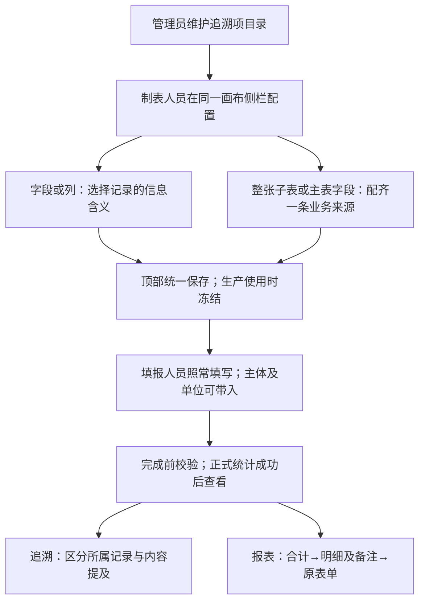

# 表单投影第二轮注释澄清（2026-10-09）

后续澄清：2026-10-10已明确草稿/无上下文、可空物料批号与单位、保存/暂存后过程追溯及二期已有事实报表方向。对应未决/建议状态以[第三轮澄清](form-projection-design-clarifications-2026-10-10.md)和DEC-0075后续条目为准，本报告保留原时点。

L2 设计澄清与知识更新；读取基线 0.3.24，HEAD `b63d68ee299de9a286bf4cc1cad0d0d829e39217`，分支 `form-traceability-projection`。未改运行代码、迁移或数据库，未进行浏览器验收。复用 `form-traceability-projection-decision-package.yaml`。本报告接续第一轮注释评审；只有本轮明确确认的部分进入正式知识，其他仍为建议。

## 已确认与未决的区别

`user-confirmed`：注释1允许MVP开发历史修复迁移或作废，不再承担旧试验数据兼容；注释13确认预置“生产批次/SN”表示本单所属主体；注释15确认查询条件主表按同一表单、子表按同一实际行匹配。这三项已交接本体同步，不能再当作未确认候选。开发历史处理政策不取消未来正确数据的使用时快照，本轮没有实际处理数据。

注释5/10延续已确认统一画布侧栏方向，具体操作见以下建议。单位、日期、多选、补充展示、自动回写时机及完整校验生命周期仍为待实现建议；不将用户提问升为完整 confirmed 契约。

## 十五条注释的结论与依据

1. **MVP历史**：接受新政策，替代对本功能开发历史一律保留及旧格式兼容的要求，不建设新旧双轨。实际迁移/作废时明确环境和记录范围属于执行工作，不要求再次批准本政策。未来正确数据仍随使用冻结配置，不随最新模板重算。此政策不外推为删除真实客户生产证据。

2. **冠骋内容反查与结果样式**：原始 `FormTraceManager` 分别保存实例所属 `subjectNo` 与指定追溯字段的 `materialNo`；`OnlineFormInstanceReverseTraceBs` 用索引取表单ID，`EdhrInstanceReverseTraceBs` 用索引的所属主体找DHR。确有按特定追溯字段内容反查表单/所属DHR的源码路径，不是任意普通文本全文检索；未运行其页面，不保证任意A/B案例和最终样式已验证。我们的建议是按统一列表规范区分“所属生产记录”和“内容提及记录”，显示“所属/提及”文字标记、真实所属生产批次/SN、命中字段及行。提及B的A表单仍显示所属A，DHR链接指向A；不能只靠颜色或把它收入B的DHR。额外风险：冠骋先跨行收集各类字段值，再 `Sets.cartesianProduct` 生成组合，可能拼出不同实际行的信息，不能照搬。

3. **不存在的生产对象**：建议采纳语义分开：“生产批次/SN”必须对应系统内且与真实执行主体一致的对象；外部编号用自定义文本追溯项。填报时明确提示不存在/与当前主体不符，完成前校验；生产场景优先自动带入当前主体并显示来源。允许草稿暂存未完成输入、无生产上下文如何处理、自动带入具体时机仍需Q17收敛。此前“查不到对象仍查询编号内容”的建议只适用于外部编号等纯内容含义，不能成为预置所属主体接受任意外部值的理由。

4. **相关批次内置项**：建议MVP不保留独立“相关生产批次号”内置项。当前0108确实将 `lookup_related_batch` 建成内置项，这是实现事实。管理员可定义内部联系“关联生产批次/SN”，在产品允许的系统对象类型内引用；外部编号另定义“外部批次号”文本项。两者不能混成同一实体类型。不需要追溯就不配。目录移除/重建/迁移在后续实现利用注释1的开发历史政策处理，本轮没有修改运行目录。

5. **子表列编辑**：建议列只显示“来自上料明细的实际消耗配置；本列为消耗物料”等角色摘要，按钮叫“编辑子表用途”。点击后选中整张子表，侧栏标题与画布选择一起切换，保持同一画布/入口，修改同一份配置。列级追溯仍可就地配置，不必创建另一笔统计业务。不在单列窗口暗中修改其他列来源。

6. **单位字典/default**：方向合理：字典维护单位；制表时配置单位字段候选与默认值，填报时需要才调整。固定单位表可默认“件”。当前字典引用返回 `{id,sourceType,code,name}`，统计单位只接受文本/单选标量，需适配为稳定单位值与当时显示名称。默认值必须实际进入填写值，不能只是提示或模拟预览；当前运行子表新增行为空对象，不能断言生产新增行已持久化默认值。字典不等于换算，仍按确定单位隔离合计，不混加件与千克。

7. **外部物料批号**：当前已允许。`materialLotText` 读取文本，不检查批号存在仓库；可以填供应商/现场批号，不产生库存关系。当前物料身份来自物料主数据引用，与物料批号独立。允许未登记批号不等于允许空批号；不管理批号时的空值/不适用策略仍需另定，本轮不取消非空校验。

8. **统一保存/校验**：建议用途编辑仅更新同一设计状态，没有局部保存；顶部“保存”统一保存并检查配置，缺项可提前就地提示。不能因用户提到“保存发布”而恢复曾否决的新增发布冻结，仍在生产使用时冻结。模板来源完整性与运行实际值校验不同，完成前仍校验数量、单位等实际值。若允许保留未配齐设计草稿，需明确不可作为完整生产配置；顶部保存的草稿策略及既有使用校验衔接仍是生命周期细节，不擅加发布按钮。

9. **备注等报表列**：推荐“汇总→来源明细→原表单”。预设用途增加可选“明细展示列”，选备注1/2，保留逐行字段身份、名称与填写值，只在明细显示，不自动成为合计维度。汇总行不任取第一条备注或拼字符串；下钻分别显示。不同模板按来源模板展示额外列，仅明确配置同一业务含义后才合成通用列。这不需要自定义统计模型。普通备注仍从原表单查看，只有需报表明细展示时才配置。

10. **主表统一侧栏**：不增加“业务配置卡片”模块。之前“卡片”是侧栏排版建议，命名造成了歧义。普通字段仍在同一侧栏选“实际物料消耗”，一次配齐物料、批号、数量、单位，显示“由主表这些字段组成一条明细”。再点参与字段只显示角色，修改同一配置；确有第二笔业务才增加另一套来源。不从各字段反复建业务，不要求日常选择隐藏内部记录组。

11. **统计/date/multi/二期**：本轮补查实际消费，而不只读字段声明，结果见下表。建议支持日期范围追溯和预设报表明确业务日期，不能用创建/完成日期偷换；需明确日期/时间类型、时区与范围边界。当前文本目录尚无此能力。多选不是MVP数量统计必需；先保留普通填写与来源查看，后续标签包含筛选可独立扩展，不能把10件同时计入两原因变成20件，分项数量/分摊另定。二期基于现有事实的选列、筛选、分组、图表、保存视图，不要求先开放客户自定义业务用途；需元数据、合法聚合、单位隔离、保存与权限，现有硬编码页面/查询仍须改造，范围限定后可控，无需求清单不估工期。客户自由造模型/公式/跨事实连接/分摊则是明显更大能力，涉及粒度、去重、校验、审计，与视图自定义不同，不进MVP。

12. **名字与无痛提示**：不建设字段名识别或额外确认。客户可任意命名，低成本引导仅显示已选用途含义、当前来源角色及已有预览，不加必填配置或教学弹窗。“名字看起来不像批次”不警告或阻断；主体不存在/与上下文冲突、来源类型不兼容、数量单位缺失等改变正式结果的问题仍须检查，不能用命名自由替代数据正确性。

13. **所属主体**：已确认并同步正式知识。批次/SN为同一生产对象概念的两种形态，对外统一“生产批次/SN”。真实归属来自执行上下文；兼容且正确表达含义的文本/引用都可采用，但同号不能改写实际归属。自动带入的完整生命周期还未确认。

14. **未知单位**：注释6字典/默认能降低填报成本，建议采用；它不能说明实际单位未知时可以进入正式合计。建议未知时提示补齐，最终完成前不形成无单位数量，不混算不同单位。该建议未被写成用户已确认的新单位规则。

15. **查询组合条件**：是查询条件，已确认。例如两行“物料M1/批号L1”“物料M2/批号L2”，查“M1且L2”不命中；主表工单条件可再限定该表单。不同子表组合、同项多个值的AND/OR、可查状态及索引更新时机未因此一并确认。

## 冠骋核心消费证据

| 原始消费者 | 实际核对结果 | 本项目取舍 |
| --- | --- | --- |
| OnlineFormDataCatchService 报工 | 提取良品/不良/报废、业务日期、起止时间、工时、原因分类；保存主体、工单、产品、工序、来源表单 | 区分度量/维度/来源；引用不是只能追溯不能统计 |
| 同服务报废 | 主表/子表提取报废来源，保存产品、主体、工单、工序、表单 | 不能由报废实体名推断申请/批准/实际口径 |
| 同服务实耗 | MATERIAL_CONSUME子表；实际量/需求量；所选产品单位；生产标识不存在抛异常；另有库存路径 | 借鉴行事实和单位来源；不照搬物料批登记要求及库存副作用 |
| ProductNumDataService | 批次/工艺节点合计；最终产出工序良品和写批次产量，再汇总工单下批次 | 保留已确认工序→最终产出工序→批次→工单层级；冠骋取良品不自动替代本项目产出口径 |
| BizReportDataSearchBs | 当天处理日期/当前修改人筛选后直接累加数量/工时，方法不分工序单位 | 不偷换业务日期/报工人，不以工作台代表全部统计 |

这是代表性核心路径核对，不是所有报表页面及平台SDK算法的穷尽验收。日期实际被消费者使用，多选贡献/分摊没有充分原始证据。

## 候选用户流程

流程不决定独立追溯索引生效时机；图中完成路径是当前查询实现事实，不据此关闭Q15或Q17。

## 当前差距与收尾范围

- 目录仍分批次/序列号且有相关批次内置；组合查询按内部记录AND，主表自动配组受添加顺序影响；新语义尚未运行实现。
- 追溯还可能命中统计共用属性，未勾追溯的查询覆盖边界须明确后分开实现。
- 单列可编辑整份统计，待改明确跳转子表视窗；单位字典适配、实际默认值持久化、系统行身份、备注明细展示、日期能力仍有缺口。
- 系统行身份要贯通保存、签名定位、重试、回查，不能仅改React key；当前仍要求唯一行字段。
- 最终产出工序→批次→工单联动尚未完成。A12受控修订/作废运行联动仍延期；开发数据允许作废不等于实现A12。

L2影响复用主决策包：直接影响主体含义、查询粒度及MVP开发历史政策；传递影响结果导航和DHR解释；潜在影响自动带入、目录类型、单位与展示列；使用时快照、真实审计归属与授权来源继续保留。扩展路径 `configuration`、`product-core`，无客户条件分支。正式知识验证入口 `mvn -Dtest=BusinessKnowledgeModelTest test`，随后独立质量审查；实际结果另列，不声称本轮完成API/浏览器/迁移/E2E。

`original-evidence` 本机冠骋根 `/Users/ivenwang/Documents/iven space/gct-edhr-bed/gct-edhr-bed/src/main/java/com/gct/apaas/edhr`（外部源码不随分支分发）：

- `notebook/FormTraceManager.java`：85–173跨行收集及笛卡尔组合、215–248递归子表、264–277真实主体。
- `edhr/biz/OnlineFormInstanceReverseTraceBs.java`：51–76反查表单；`EdhrInstanceReverseTraceBs.java`：51–76反查DHR；`EdhrReverseTraceBs.java`：34–43、77–95实际DHR范围与字段筛选。
- `bizProcess/service/OnlineFormDataCatchService.java`：报工提取/保存、报废提取/保存、599–727实耗行与单位/生产标识。
- `service/ProductNumDataService.java`：39–153节点合计、最终产出标记及工单累加；`workbench/biz/BizReportDataSearchBs.java`：42–79工作台消费。

本项目根下：`gmp-platform/backend/src/main/java/com/zencas/edhr/template/service/FormReferenceLookup.java` 字典结构、`FormProjectionInterpreter.java` 物料批文本及单位兼容、`production/controller/FormProjectionController.java` 当前组合及DHR关系；`gmp-platform/frontend/src/components/form-renderer/FormRuntimeField.tsx` 实际值及新增空行。旧调研仅作 `secondary-reference` 索引，本轮回到源码；本文“建议”均为 `inference`，不是已运行或客户易用性验收证明。
