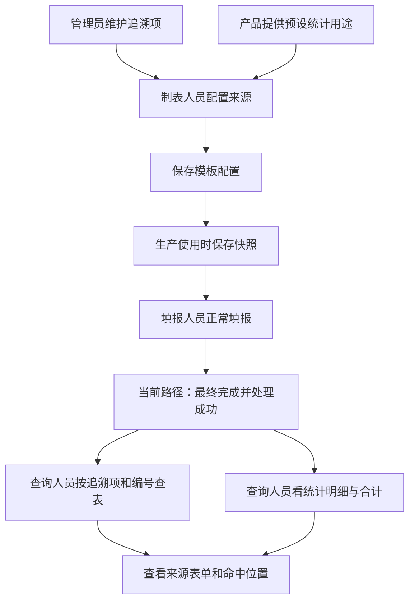

# 表单设计用途侧栏：现状解释与设计评审

日期：2026-10-09。执行级别：L2 设计评审。复用 `DEC-PACKAGE-20260929-FORM-PROJECTION`，知识基线 0.3.24，源码基线 `b63d68ee299de9a286bf4cc1cad0d0d829e39217`。

本轮只核对并解释，不修改产品代码、测试、配置或数据库。下述操作描述是当前实现；优化建议是 inference，不能视为已实现、用户新确认或客户易用性验收。例子使用用户本轮截图中的上料子表，是示意数据，不冒充本轮重新核对过的安速康原始表单。

## 评审结论

将正常填报与数据用途分开，以及统计中保持“同一笔明细”的边界，是合理的底层方向。但当前侧栏混合了字段含义、整笔来源配对、启用、展开和删除，用户需要理解内部绑定才能操作。问题主要在交互设计，不能靠增加说明文字解决。

截图中的批次字段只有追溯，物料列两种都有，是当前预设统计模型及类型兼容范围的结果；它不是所有业务场景的天然限制。应说明限制原因，而不是仅隐藏入口。

## 两种用途和正常录入的关系

| 用途 | 制表人员在声明什么 | 查询人员能做什么 |
| --- | --- | --- |
| 追溯 | 这个字段/这列记录的是哪种业务信息，例如物料批号、生产批次号或灭菌锅次 | 在追溯页面选择该追溯项、输入编号，找到来源表单及命中位置 |
| 业务统计 | 哪几个字段/列共同描述一笔实际消耗、报废或报工，以及每个字段在这笔业务中的角色 | 在预设报表查看明细和按已确认维度合计的数量，再回查原表 |

填报人员不需要理解投影：文本仍输入编号；引用仍选择对象；子表仍按行录入。两种用途可以只配其一、都配或都不配。关闭用途不取消原生引用选择或原始记录保存，也不改变既有 DHR 真实关联。



图中完成时机描述当前内容检索/统计实现，不替 Q15 的独立检索索引时机定版，也不表示所有 DHR 证据必须最终完成后才能查看。完成前做必要业务/配置校验；系统投影失败保留已完成表单、显示状态并可重试。查询当前只读处理成功的结果。

## 如何配置追溯

以“填写的生产批次号”文本框为例：

1. 在画布中选择该字段，进入左侧“查找与统计”。
2. 展开“用于查找与追溯”，在“关联追溯项”选择“生产批次号”。这声明字段含义，不选择某一个批次，不把填报输入框改成查询框。
3. 核对上方已关联项及启用状态；普通主表来源完整时可自动启用。点顶部“保存”。
4. 填报人员仍输入 `B001`。当前路径最终完成并处理成功后，查询人员在追溯页面选择“生产批次号”、输入 `B001`，查看命中的表单和位置。

引用字段“选择的生产批次”可以关联同一个追溯项。填报时选择 B001，记录保存对象 ID、类型、编号和显示值；追溯用保存的编号，不用显示名称或最新主数据替换历史编号。文本输入 B001 与引用选择 B001 都可以按同一个追溯含义检索，不要求客户强制统一字段类型，也没有文本填写后再手工选择一次批次的步骤。

“生产批次号”与“相关生产批次号”表示不同业务含义。前者可表示表单中记录的生产批次号；后者表示记录中提及的其他生产批次。不能因为引用类型兼容两项，就把一个字段都关联两项。两个字段确实表达同一含义时可关联同一项，单条件查询按来源表单去重并保留命中位置；如果两字段填了不同编号，当前系统不会自动判断哪个正确。

自定义追溯项：管理员可在追溯项管理创建“灭菌锅次”等名称/说明；当前自定义项支持文本精确匹配，制表人将文本或单选来源关联该项，查询页自动提供同一项。新建名称不会自动产生批次、设备等原生引用的兼容规则，也不会覆盖未关联该含义的旧快照。

子表列配置对每行生效。例如“上料明细 / 物料批号”关联“物料批号”，无需逐行配置。目前还要求为子表用途配置文本/单选的非空唯一行定位字段，可暂用“明细编号”01、02。物料批号可能在多行重复，不能因此直接当作每行唯一字段。此手工行定位是当前实现成本，Q12 的系统行身份尚未定版。

## 如何配置业务统计

截图中的上料明细如果实际记录物料消耗，优先选整张子表配置“实际物料消耗”，一次配齐各列：

| 报表需要的信息 | 示例来源列 | 作用 |
| --- | --- | --- |
| 物料 | 物料（引用） | 确定实际使用的物料身份 |
| 物料批号 | 物料批号（文本） | 区分使用了哪个物料批号 |
| 数量 | 实际用量（数字） | 进入数量统计 |
| 单位 | 计量单位（文本/单选） | 避免不同单位混加 |

还需配置当前版本要求的每行唯一字段，补齐必需项后启用，顶部保存。配置预览用于核对生成的明细；模拟填报用于核对录入方式，不等于配置已经覆盖历史实例。

填报时两行分别填写同一物料、同一物料批号的 2 件和 3 件。当前最终完成并处理成功后，会形成两条消耗明细，在同一实际生产对象、工序、物料及批号、单位下合计为 5 件。不同工序、物料批号或单位分别展示。示例数字用于解释机制，不是新的统计口径。

从单列进入也可以配置：勾选统计 → 添加“实际物料消耗” → “这个字段代表”选择“物料” → 选择补充已有业务或另配一笔 → 补齐其他来源。截图中已有“实际物料消耗 · 已启用”时，应调整这笔现有配置，不再给同一笔业务另建一笔。现有卡片代表整张明细的配置，不是物料列单独贡献一个数。

主表分散字段也支持。例如“领料物料、领料批号、领料数量、领料单位”四个字段共同形成一笔业务；不能把每个字段分别配置成四笔。当前可从其中一个字段创建用途，在来源编辑器中配齐同一主表的四个字段；第二套物料/批号/数量/单位若代表另一笔业务，再另配一笔。主表与子表目前不能共享来源：不能假定表头单位自动作为各子表行的统计单位，Q9 保留未决。

当前三种统计用途：

- 实际物料消耗：要求物料引用、物料批号、数量、单位。
- 报废记录：目前同样要求这四项，实际覆盖带物料身份及批号的报废明细，尚不能笼统称为任意报废场景。选择客户明确代表报废数量的数字字段，不自动猜申请量、批准量或处理量。
- 正式报工：当前为良品/不良品数量（至少其一）及单位等；独立产出语义字段，以及最终产出工序到批次、工单的产出联动尚未补齐。不能把良品数量擅自等同于产出。

重复记载同一笔业务的表单宜只配追溯，不再参与正式统计。现有重复数量来源校验不能证明不同表单/不同字段不是重复记载，不能宣传为自动识别所有重复业务。

## 为什么选项不同

当前系统按可支持的取值类型筛选，尚不理解字段名称或实际业务。

| 当前字段类型 | 追溯 | 统计 | 当前原因 |
| --- | --- | --- | --- |
| 文本/单选 | 有 | 有 | 可用于编号检索，或提供统计的单位、批号、原因等配套信息；不能作为数字数量 |
| 数字 | 无 | 有 | 用于数量；当前追溯项不支持数字类型检索 |
| 物料引用 | 有 | 有 | 可按物料编码查表，也可作为消耗/报废的物料身份 |
| 批次/SN/工单/设备/产品引用 | 有 | 无 | 当前预设报表未以这些字段作统计来源；生产归属另由真实执行提供 |
| 人员/部门/字典/工序等引用 | 当前无兼容预置项 | 当前无兼容项 | 原生选择正常，但本轮没有对应投影用途 |
| 日期/多选等 | 当前无 | 当前无 | 当前模型不支持 |

所以文本“生产批次号”也可能看到单位、原因等统计角色候选，尽管业务上不该如此配置。兼容不等于适合，缺少解释和推荐排序是当前设计缺陷。

## 截图按钮的真实作用

| 控件 | 当前真实作用与需要注意的范围 |
| --- | --- |
| 顶部两种用途复选框 | 勾选可能只展开配置，不等于已启用；取消会删除当前字段对应映射。整子表层级取消会移除该子表相应整类用途，不能当作收起按钮 |
| 关联追溯项 | 向当前字段增加一个业务含义；是添加入口，所以选择后仍显示空选择框，已关联项列在上方 |
| 已关联项旁“移除” | 移除该项与当前字段的一条对应关系 |
| 调整追溯来源 / 补齐或调整来源 | 打开整项来源配置，可能编辑其他字段，范围超出了当前选中字段 |
| 启用此用途 | 控制这一整项配置是否参与后续使用；与顶层复选框不是同一件事 |
| 移除用途 | 删除整项配置及其中其他字段的映射，不只是移除当前字段 |
| 顶部保存 | 保存当前模板设计；侧栏“已启用”不等于已经保存、生产实例已使用或历史数据已覆盖 |

截图2选择的是“选择的生产批次”，展开却出现“生产批次号 → 填写的生产批次号”，因为它打开了一组包含两个字段的来源映射。该行为有源码依据；用户看到它感到范围不清楚是合理的交互问题。

## 内容、引用、真实归属不能混淆

例如表单实际属于生产执行批次 A，但文本或引用中提到 B：按 B 的内容可以查到这份表单；统计归属仍来自实际执行 A；DHR 仍沿 A 的真实生产关系查询。自由文本不会变成实体，引用对象 ID 也不会自动把这份表单改挂到 B 的执行或 DHR。

模板配置随生产使用形成快照；旧实例继续读旧配置。不新增发布冻结步骤。正式结果仅在最终完成后生成，系统处理故障不撤销已完成表单，下游依赖正式结果时须等待成功。

## 除交互之外的实现问题

1. 当前追溯多条件要求同一投影记录同时命中。子表是同一投影行；主表则受内部字段分组限制，不能解释为同一表单任意字段各自命中即可。新增追溯字段自动寻找可容纳的已有组，配置点击顺序会改变配对。例如先配置批号1、设备1、批号2、设备2，与先配置批号1、批号2、设备2、设备1可产生不同配对。多条件查询结果因此可能变化。这是应修复的设计问题，不能要求客户学习隐藏分组来解决。
2. 当前表单追溯查询没有限定仅 `formTrace` 记录，也能命中统计记录中的共用属性，例如物料批号。因此“未勾追溯就一定不能被追溯页查到”不成立。两项用途在 UI 上并列，但查询边界尚未完全分开；后续不能未经兼容核对就直接加模型过滤并丢掉原有可查询记录。
3. 当前报废形状偏物料明细、正式产出联动不足、表头共享未做、行身份需要用户手填，均应明确列为范围差异，而非只做样式修复。

## 优化建议（inference，未实现）

- 日常追溯只让制表人选择“这个字段是什么信息”，显示可移除的追溯项标签；不默认暴露整组来源编辑。跨字段操作必须有清晰范围标题。
- 统计以整张子表为主要入口：选择“这张明细表记录什么”，一次配齐列。选择某列时只显示其角色及“编辑上料明细的统计配置”。主表则用一张清晰卡片配置“一笔实际消耗/报废”，保留首期支持。
- 展开/收起、关联/移除、启用/停用各自承担一种作用。明确区分未配置、待补齐、已配置、未保存修改，不用层层复选框表达。
- 配置旁展示一行样例：“每行记录一种物料、一个批号及其实际用量和单位”；预览生成的明细与合计口径，方便确认配置结果。
- 不适用用途给出简短原因，例如“批次和工序归属由生产执行提供”；不因某字段碰巧是文本就暗示它适合任何角色。
- 先修正与配置顺序无关的稳定追溯关联及组合查询契约，再简化 UI；行身份等未决项保留明确设计工作，不静默替用户确定。
- 页面继续遵守仓库统一 UI/UE 规范并保留画布内同级入口、当前选择与统一保存。二期自定义统计报表、历史新含义补索引及 A12 修订/作废联动不纳入本轮。

## 证据与门禁范围

original-evidence：本轮用户三张原始截图；当前原始源码：

- `gmp-platform/frontend/src/pages/master-data/template-designer-react/components/FieldProjectionConfig.tsx:21`（范围）、`:37`（追溯分组）、`:61`（复选框）、`:71`（整项编辑）、`:100`（单字段统计）。
- 同目录 `SubTableProjectionConfig.tsx`、`ProjectionSourceEditor.tsx`，以及 `../utils/projectionConfiguration.ts`（类型过滤、必需项、同区域来源、行定位）。
- `gmp-platform/backend/src/main/java/com/zencas/edhr/template/service/FormProjectionInterpreter.java`、`FormLookupCatalogService.java`（模型、类型、目录与冻结解释）。
- `gmp-platform/backend/src/main/java/com/zencas/edhr/production/service/FormProjectionService.java`、`ExecutionSnapshotBuilder.java`（完成、重试、使用时快照）。
- `gmp-platform/backend/src/main/java/com/zencas/edhr/production/controller/FormProjectionController.java:40`、`:47`、`:78`、`:108`（成功结果、同记录组合、合计、实际 DHR）。
- `gmp-platform/frontend/src/pages/reports/FormProjectionReportPage.tsx`（查询输入与来源回查）。

user-confirmed：现有 DEC-0060 与 DEC-0075 中的两用途并列、统计产品维护、实际归属、使用时快照、子表重点但包含主表分散来源、MVP 预设报表、统一追溯项术语。secondary-reference：已有设计、交接及以往验证记录仅辅助定位，本轮实现判断回到原始源码/截图。inference：本文件优化建议及易用性判断。未重新核对冠骋或安速康原始资产，不作新的竞品断言。

复用原决策包的影响分析增量：

```yaml
impactAnalysis:
  level: L2
  directImpacts:
    - area: customer-explanation
      change: 说明当前追溯、统计、引用、侧栏操作和范围差异；不改变产品行为
      evidenceReferences: [FieldProjectionConfig.tsx, ProjectionSourceEditor.tsx, FormProjectionInterpreter.java]
  transitiveImpacts:
    - area: reports-and-dhr
      change: 防止把内容查询含义误当实际归属或把同记录组合误当同表任意命中
      evidenceReferences: [FormProjectionController.java]
  potentialImpacts:
    - area: future-sidebar-and-query-repair
      concern: 优化会涉及来源分组、查询兼容与配置状态，须在后续实施切片明确验收
      evidenceReferences: [FieldProjectionConfig.tsx, FormProjectionController.java]
  unaffectedAreas: [产品运行代码, 数据库, 现有电子签名与放行流程]
  compatibilityAndMigration:
    - 本轮不迁移；后续不能默默改写旧快照或直接限制查询来源导致历史结果消失
  snapshotImpacts:
    - 仅解释使用时快照，不增加发布冻结，不回填旧实例
  auditImpacts:
    - 本轮不改变审计；引用保存值、配置快照、来源位置按现有证据解释
  permissionImpacts:
    - 本轮不改变权限，也不承诺超出当前接口授权范围的可见性
  testImpacts:
    - scope: explanation-review
      scenarios: [类型矩阵, 来源编辑范围, 复选框作用, 分组与组合查询, 统计必需项, 实际归属与快照]
      evidenceReferences: [当前原始源码与用户截图, 独立本体核对, 独立质量审查]
  evidenceGaps:
    - 未运行新测试或浏览器、数据库验证；本轮无运行代码变更
    - 尚无工厂客户可用性试验，不能用以前自动化通过替代用户易用性验收
    - Q6/Q9/Q12/Q15/Q17和A12保留原状态；不阻塞准确解释当前实现，不代表这些功能已解决
extensionStrategy:
  selectedPaths: [configuration, product-core]
  rationale: 客户选择字段含义和预设来源属于配置；类型兼容、行身份、组合查询和统一交互属于产品内核
  ownershipBoundaries:
    - owner: template-designer
      responsibility: 字段/整笔来源的清晰交互和统一保存
    - owner: form-projection-and-query
      responsibility: 稳定解释、快照兼容、检索与统计契约
```

本体独立核对结果：`ontologyResult.result: not-applicable`，基线 0.3.24 不变；原因是本轮只读核对既有语义，没有新增知识规则。独立质量仅验收解释和评审记录的准确性，不验收当前产品 UX 或完整 MVP。
